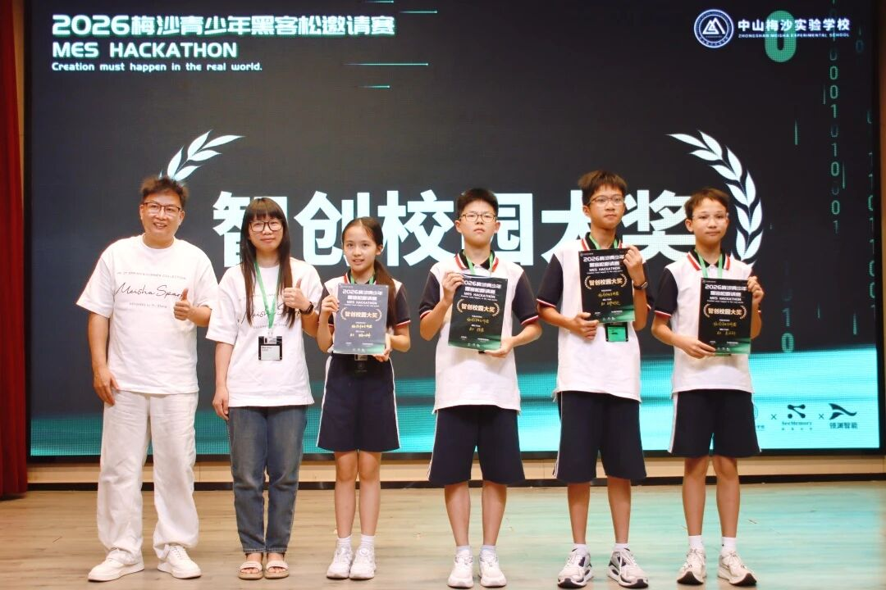

# 校园作业分析 · Smart Campus Homework Analyzer

**v0.2.0-rc1** ｜ MIT License

[English](README.EN.md) | 中文

校园作业分析器：上传作业，AI 识别批改，教师复核后自动生成班级学情、知识点掌握率、错因统计与讲评课方案。所有数字由已复核数据确定性计算，AI 只负责转写成课堂语言。

---

这是可在学校或个人服务器运行的全栈版本。账户、学校、学生、知识库、作业、OCR、教师复核、错题本、试卷与 AI 教学分析均使用持久化数据。

## v0.2.0-rc1 新增：AI 教学分析

面向教师课堂讲评的新板块，直接消费教师已经复核的错题，把“批改结果”变成“能上课的内容”。

- 班级学情画像：已复核答卷数、班级得分率、错题数与错因占比、无法辨认题目的单独提醒。
- 知识点掌握率：按题号聚合到校本知识点，从最薄弱开始排序，直接指出本节课要先补的漏洞。
- 错因归因：内置 12 类错因（概念混淆、审题偏差、计算粗心、步骤缺失、公式记忆不牢、条件遗漏等），先用关键词规则确定性归类，教师可再点“AI 重新归因”让模型结合题干与知识点复核；错因按题号严格划分，占比之和恒为 100%。
- 高频错题讲评单：按出错人数排序，展开即可看到出错学生、参考答案、分步解析、同类练习，以及 AI 生成的“讲给学生听 / 板书演示 / 讲完立刻检查”。
- 课堂讲评课方案：主题、课时、目标、时间轴（讲什么、教师做什么、学生做什么）与可照写的板书设计。
- 分层辅导与错因干预：每个错因配一个 5 分钟内可执行的课堂动作，并给出可直接点名的分层辅导名单。
- 课后作业：只针对本次出错的知识点，可一键把选中的高频错题生成新的重练作业。
- 学生跟进名单：标记“观察 / 跟进 / 重点”，一键生成该生的个别化诊断（薄弱知识点、错因剖析、补强动作、针对性练习、给家长的一段说明）。
- 导出：一键导出 Markdown 讲评单，或直接打印成 A4 讲评单带到课堂。

统计口径说明：只有教师在“识别与复核”确认过的错题进入统计；判为“无法辨认”的题目单独列出，不计入学生错因占比，避免因为扫描不清而误判学生掌握情况。

## 项目组

本项目作为中山梅沙实验学校的首届梅沙黑客松限时完成的参赛作品，获得了 **最高奖项（智创校园大奖）** 。
具体内容：[中山梅沙实验学校的公众号文章：36小时，我们见证了一场狂欢](https://mp.weixin.qq.com/s/H2DiIkaNx56Y_fUoRV-HzA)


B3组 校园作业分析器

导师：陈银香  
组员：欧阳进达、吴汶轩、胡以琳、程诺、黎敦文  
项目后期维护组（贡献者）：（WWX、CN、ZYH）
<a href="https://github.com/turtle-Owen">
  
</a>
<a href="https://github.com/Tom505915-Zhang">
  
</a>





## 安全性声明

本项目为 **DeepSeek V4.1-Flash** 与 **Qwen 3.8 Max**（在 DeepSeek Harness 上运行）和 **GPT 6 Sol**（在 Codex 上）辅助完成。所有 AI 生成的输出均已由开发者审核、验证并整合，开发者对最终代码库和文档保留完整的著作权和责任。

详细的安全信息、负责任使用指南和数据隐私注意事项请参阅 [SAFETY.zh.md](SAFETY.zh.md)（[English](SAFETY.md)）。


## rc5 能力

- 独立注册学校管理员账户；学校账户不设置学段、学科或班级，用于查看全校数据并创建教师、学生账户。
- 教师单个注册学生，或通过 CSV/XLSX 一次导入最多 500 名学生。
- 新增作业时可上传 JPG、PNG、WebP、PDF、DOCX 或 DOC：PDF 逐页 OCR，DOCX 提取正文、表格与内嵌图片，DOC 提取可读取文字，统一生成可编辑草稿。
- PDF 在服务器转成页面图像，不再要求用户手工转图。
- 学生作业上传后与正式题目严格对齐；OCR 建议经教师复核后才写入错题本。
- 作业导入会自动补充标准答案、评分要点和缺失知识点；教师主要进行抽查和修正。
- 错题自动生成分步解析与同类型练习，学生全部答对后标记知识点过关。
- 10 个模型厂商预设，API Key 在服务端使用 AES-256-GCM 加密。

## 一键部署（Windows）

仓库自带一个 C++ 控制台部署器（`tools/deployer/`），可在任意 Windows 电脑上自动检测并安装依赖、准备源码、构建并启动服务，再按需开放局域网或公网访问：

```powershell
# 构建部署器（需要 MinGW-w64 或 MSVC + CMake，产物约 3 MB 单文件）
powershell -ExecutionPolicy Bypass -File tools/deployer/build.ps1

# 使用
dist-deployer\campus-deploy.exe                 # 交互式菜单
dist-deployer\campus-deploy.exe --web           # 浏览器可视化部署控制台
dist-deployer\campus-deploy.exe --mode lan      # 局域网：同一网络内设备均可访问
dist-deployer\campus-deploy.exe --mode tunnel   # Cloudflare 临时公网地址（https）
dist-deployer\campus-deploy.exe --mode domain --domain hw.example.com --api-token cf_xxx
```

它会自动检测 Node.js / cloudflared / curl / git，缺什么装什么（优先 winget，失败则官方下载）；源码不在本机时从 GitHub 获取。详见 `tools/deployer/README.md`。

## 本地或服务器运行

要求 Node.js 24+。

```powershell
npm install
$env:APP_SECRET="替换为至少 32 位随机字符串"
npm run build
npm start
```

开发时分别运行 `npm run dev:server` 和 `npm run dev`，访问 `http://127.0.0.1:5173`。生产服务默认监听 `127.0.0.1:8787`，可用 `HOST=0.0.0.0` 放开为局域网可访问；数据位于 `data/smart-campus.sqlite`，原件位于 `data/uploads/`。

## 安全更新（2026-10-17）

教师账户须由学校管理员创建；公开注册只允许学生。学生不能自行修改学段或班级。答卷与原件仅允许学生本人、任课教师及本校管理员读取，学生作业详情不返回标准答案；重新识别须再次人工复核。

模型接口默认只允许所选厂商的 HTTPS Origin。自定义网关须由部署管理员在 `PROVIDER_ALLOWED_ORIGINS` 配置精确 Origin（逗号分隔）；已有非白名单配置也会在调用时被拒绝。不要把用户可控制的域名或内网地址加入白名单。通过 Worker/反向代理访问时，在源站设置 `APP_ORIGIN=https://你的前端域名`，不要附加路径或末尾斜杠。服务不信任客户端传入的 Forwarded 头。生产环境要求有效 `APP_SECRET` 并使用 HTTPS（会话 Cookie 为 Secure）。

环境变量须实际传给进程；使用 `.env` 时以 `node --env-file=.env server/index.mjs` 启动。审查发现、回归范围与残余限制见 [SECURITY_REVIEW.md](SECURITY_REVIEW.md)。

## 正确使用顺序

1. 选择“注册新学校”，填写学校与管理员资料。
2. 在“学生管理”下载模板并导入学生，或单个创建账户。
3. 在“知识库”维护本校实际知识点。
4. 在“新增作业”上传图片、PDF 或 Word 原件生成草稿，补全答案、分值和知识点后发布。
5. 教师或学生选择正式作业并上传学生答卷。
6. 教师在“识别与复核”启动逐页 OCR，逐题核对后确认。
7. 已确认错题进入对应学生账户和错题组卷池。
8. 在“AI 教学分析”选择这份作业，生成讲评方案、错因统计与学生跟进名单。

## 答卷与复核修复（2026-10-17）

一次上传中的多个文件现在属于同一位学生的一份答卷，按选择顺序合并识别；不要在一次上传中混入多个学生的文件。数据库启动时自动新增 `submission_files` 表，既有单文件答卷仍可读取。历史上已拆成多份提交的文件无法可靠推断页组，因此不自动合并；如需纠正历史统计，请重新上传完整答卷并人工核对。

复核页按正式题号显示题干、满分与可编辑得分，正误和得分保持一致，服务端按逐题得分重算总分。切换学生不会覆盖另一人的识别结果；异常模型结果可重试。学生练习接口不再返回参考答案；新模型判分须使用 JSON 布尔值。重新识别期间旧错题不进入错题本、练习或组卷。学情统计保留满分学生、无错知识点，同名学生按账户 ID 隔离。

## 测试与校验

```powershell
npm test            # Vitest：错因归类、班级统计口径、数据隔离、AI 归因融合
npm run build       # 严格 TS 检查 + 生产构建
npm run verify:teaching   # 教学分析接口端到端校验（使用夹具数据，不调用付费模型）
```

`npm run verify:teaching` 会在 `.tmp-teaching-verify/` 下生成一份夹具数据库并启动一个临时端口，逐项校验教学分析的读写接口、统计口径与权限边界，结束后自动清理。它只验证确定性部分，AI 生成接口在未配置 API Key 时会确认返回清晰的报错。

## Cloudflare 免费方案

Cloudflare Worker 只托管静态前端并代理 `/api/*` 到你的源站，不依赖 D1 或 R2。先在服务器启动主服务，再使用 cloudflared 暴露 8787 端口，并把 HTTPS 源站地址写入 `wrangler.jsonc` 的 `ORIGIN_URL`。

```powershell
cloudflared tunnel --url http://127.0.0.1:8787
npm run build
npx wrangler deploy
```

## 上线前事项

- 设置固定 HTTPS 域名、强随机 `APP_SECRET` 和每日离线备份。
- 完善邮箱验证、密码找回和学校成员身份核验。登录限流目前按源 IP 计数，反向代理后可能共享额度。
- 为上传文件增加病毒扫描，并制定原件、识别文本和账户数据的保留/删除制度。
- 与 OCR 厂商确认未成年人数据处理条款，用学校真实样本评估识别率。
- SQLite 适合单机或单写节点；多节点需要迁移到外部数据库和对象存储。

模型能力和接口格式会变化。当前 OCR 使用 OpenAI 兼容的视觉消息格式；不兼容该格式的厂商需要增加独立适配器。

## 目录结构 / Directory Structure

| 目录 | 说明 |
|------|------|
| `src/` | 前端源码（React + TypeScript） |
| `server/` | 服务端（Express + SQLite） |
| `public/` | 静态资源 |
| `tools/` | 部署工具与脚本 |
| `Roadshow PPT - 路演PPT/` | 路演演示文稿及素材（含中英文两套 PPTX / PDF / 网页源文件） |

| 文档 | 说明 |
|------|------|
| `README.md` / `README.EN.md` | 项目说明（中文 / English） |
| `SAFETY.zh.md` / `SAFETY.md` | 安全性声明与负责任使用指南（中文 / English） |
| `AGENTS.md` | 仓库协作与代码规范 |
| `Roadshow PPT - 路演PPT/README.md` / `README.EN.md` | 路演 PPT 使用说明（中文 / English） |

> **注意**：`src`、`server`、`public`、`tools` 为代码标准目录，保持原名以确保构建正常。非代码目录已采用中英混合命名。


### 第三轮安全与流程修复

学生账户现在由学校管理员或教师在学生管理中创建、导入；学校编号不再作为自助入班凭据，`/api/auth/register` 返回 403。既有账户保留，请学校核验历史自行注册的成员及班级。

所有模型调用统一受 SQLite 持久限额约束：默认每名学生 20 次/小时、教职工 120 次/小时、每校 600 次/小时及 3000 次/滚动 24 小时；每账户同时 1 个任务、每校同时 4 个任务。可用 `.env.example` 中 `MODEL_*` 正整数调整。限流在访问厂商前返回 429；失败调用保守计数。这是调用次数保护，不是美元费用上限，仍应设置厂商消费限额。OCR 在限额不足时保留原成绩和复核状态。

教学分析切换作业会立即清空旧内容并忽略过期响应。生成方案和个体诊断绑定当时的复核数据版本；改判后旧方案不再作为当前结果展示，生成期间数据变化返回 409，请刷新后重新生成。历史未带版本的报告保留在数据库，需要重新生成后才能展示；历史异常模型 JSON 不再导致页面崩溃。教师复核界面提供受权限保护的原件下载与标准答案，学生接口仍隐藏标准答案。

Windows 自定义域名部署会保存与新建隧道匹配的本地凭据，凭据保存失败时在修改 DNS 前中止。公网模式会重新检查 cloudflared；连接超时不再显示成功。构建缓存纳入依赖锁文件、公共文件及配置，日志按游标增量获取并限制页面记录数。完整 Windows 安装与浏览器视觉验证仍需目标环境执行。
